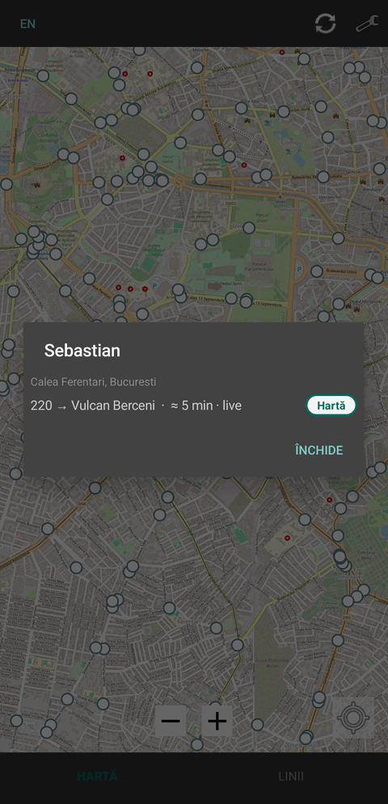

# Bucharest Transit

[](../../actions/workflows/build.yml)

An open-source Android client for real-time Bucharest public transport, built
on the open data from mo-bi.ro. It is a de-Googled alternative to the official
InfoTB app, which relies on Google Maps and Play Services.

## Features

- **Live vehicles** on the map as line-number badges, refreshed every 30 s
  (or on demand with the refresh button), from the mo-bi open-data feed — the
  same data that powers [maps.mo-bi.ro](https://maps.mo-bi.ro/).
- **Lines tab** where you can search a line either by number or by terminus.
- **Stops & arrivals**: stop markers from zoom 13 up; tap a stop for live
  arrivals. The selected stop stays highlighted.
- **Self-updating network database**: the line/geometry/stop database is built
  on-device from the official TPBI GTFS archive, cached locally and refreshed
  automatically when it is older than a day. A bundled snapshot (200 lines,
  4,532 stops) makes the first launch usable straight away.
- **Traffic & incident layers** (optional, off by default): street segments
  coloured by delay and road-hazard markers.
- **Nearby stops**: one tap away, listed by distance from your last known
  location.
- Romanian / English interface, switchable in the app.
- No account, no tracking, no Google.

## Permissions

`INTERNET` for live updates, plus optional `Location` access for the nearby-stops
list and the "my location" button.

## Screenshots

  

## Install

Android 8.0 (API 26) or newer. Grab the APK from the
[latest release](../../releases/latest). This is a debug build, so it is signed
with the Android debug key — build it yourself if you would rather not trust
that.

## Data sources & credits

| Source | Used for | Terms |
|---|---|---|
| [mo-bi.ro](https://mo-bi.ro/repo) · Bucharest–Ilfov Open Data | live vehicle positions, arrivals, traffic, incidents | open-data endpoints |
| [TPBI open GTFS](https://gtfs.tpbi.ro/regional/BUCHAREST-REGION.zip) | lines, geometry, stop sequences, schedules | open feed (© TPBI, STB SA, Metrorex SA) |
| [OpenStreetMap](https://www.openstreetmap.org/copyright) (via [osmdroid](https://github.com/osmdroid/osmdroid)) | base map | ODbL — © OpenStreetMap contributors |

**Code licence**: [GPL-2.0](LICENSE). This is original code — it consumes only
the published open-data endpoints and includes no source code from the mo-bi
project (whose frontend repository currently ships without a licence file,
despite the GPLv3 declared on their site).

## Build

Needs the Android SDK for API 35 and a JDK between 17 and 21 — Android Gradle
Plugin 8.7 cannot run on newer ones.

```bash
./gradlew :app:testDebugUnitTest :app:lintDebug :app:assembleDebug
# APK: app/build/outputs/apk/debug/app-debug.apk
```
