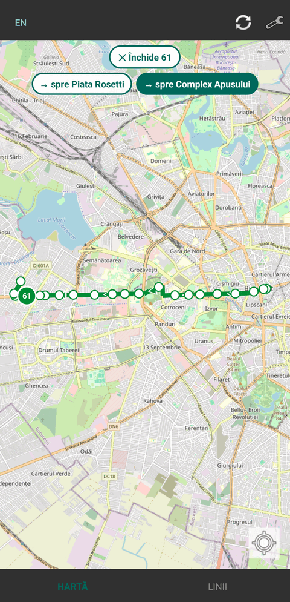
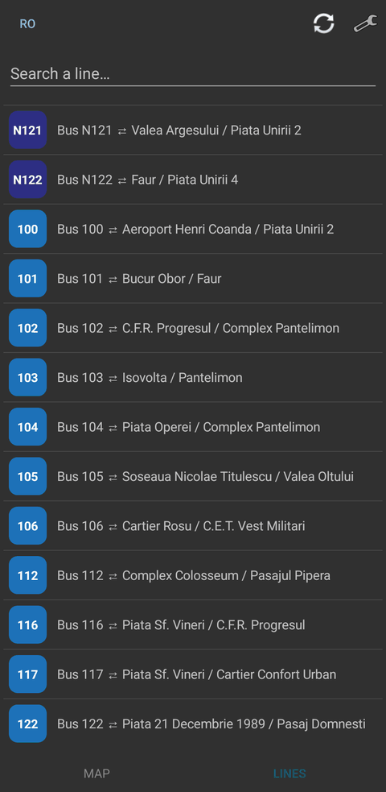
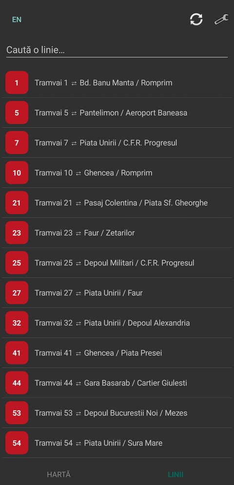

# Bucharest Transit

[](../../actions/workflows/build.yml)

<!-- uncomment once the app is accepted into F-Droid:
[](https://f-droid.org/packages/ro.bucharest.transit/)
-->

An open-source Android client for real-time Bucharest public transport, built
on the open data from mo-bi.ro. It is a de-Googled alternative to the official
InfoTB app, which relies on Google Maps and Play Services.

## Features

- Live vehicles as line-number badges, refreshed every 30 s.
- Lines searchable by number or terminus; selecting one draws every variant of
  its route, branches included.
- Tap a stop for one chronological list of every line serving it: live times
  where the feed has them, the schedule otherwise.
- Full-day timetable per line, computed on device from the GTFS archive.
- Optional traffic and incident layers. Nearby stops from your last fix.
- Romanian and English.

Needs `INTERNET`; location only for the nearby-stops list.

## Screenshots

  

## Install

Android 8.0+. APK on the [latest release](../../releases/latest).

## Data sources

| Source | Used for | Terms |
|---|---|---|
| [mo-bi.ro](https://mo-bi.ro/repo) · Bucharest–Ilfov Open Data | live vehicle positions, arrivals, traffic, incidents | open-data endpoints |
| [TPBI open GTFS](https://gtfs.tpbi.ro/regional/BUCHAREST-REGION.zip) | lines, geometry, stop sequences, schedules | open feed (© TPBI, STB SA, Metrorex SA) |
| [OpenStreetMap](https://www.openstreetmap.org/copyright) (via [osmdroid](https://github.com/osmdroid/osmdroid)) | base map | ODbL — © OpenStreetMap contributors |

**Licence**: [GPL-3.0-or-later](LICENSE).

## Build

Android SDK 35, JDK 17-21 (AGP 8.7 rejects newer).

```bash
./gradlew :app:testDebugUnitTest :app:lintDebug :app:assembleDebug
```

`app/src/main/assets/routes.json` is generated: the output of the app's own
`Gtfs` class, fed the TPBI archive.
